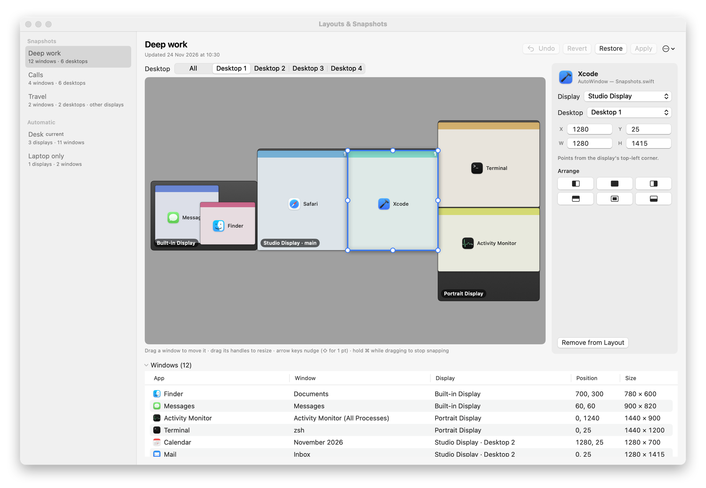

# AutoWindow

**Snap windows like Magnet. Get them all back after every unplug.**

A free, open-source Mac app that replaces Magnet: the same ⌃⌥ shortcuts snap any window to a half, quarter or third.
And it does what Magnet doesn't: it remembers where every window goes, on every monitor and every desktop, and puts
them all back when you dock, undock or wake your Mac.

[**Download**](https://github.com/Carpe-Futurum/autowindow/releases/latest) · [Website](https://zein.nl/autowindow/) · [Help](https://zein.nl/autowindow/help/)

<p align="center">
<picture>
  <source media="(prefers-color-scheme: dark)" srcset="docs/images/hero-dark.svg">
  
</picture>
</p>

<p align="center"><sub>Arranged → unplugged, macOS piles the windows on the laptop → plugged back in, AutoWindow puts each one back.</sub></p>

[](LICENSE)


[](https://github.com/Carpe-Futurum/autowindow/actions/workflows/test.yml)

## One app instead of two

Magnet moves one window when you ask. AutoWindow does that with the same keys, and also keeps every window's place
for you.

| | AutoWindow | Magnet |
| --- | --- | --- |
| Snap to halves, quarters, thirds and two thirds | Yes | Yes |
| Magnet's ⌃⌥ shortcuts | Yes, the same keys | Yes |
| Send a window to the next monitor | Yes | Yes |
| Drag a window to a screen edge to snap it | No; macOS 15 and later do this themselves | Yes |
| Put every window back when monitors come back | Yes, by itself | No |
| Named snapshots of all monitors and desktops | Yes | No |
| Price | Free, MIT licensed | Paid |

**Switching:** quit Magnet and take it out of your login items, then open AutoWindow. `⌃⌥←` is still the left
half. If Magnet, Rectangle or another window app is still running, AutoWindow's welcome window says so and offers to
quit it, because two apps on the same keys means you can't tell which one acts.

<sub>Magnet is a trademark of its owner. AutoWindow is not affiliated with it. Compared in November 2026.</sub>

## What it does

AutoWindow does two separate jobs of putting windows back. They share the idea, but they are not the same:

| | **Automatic** | **Snapshots** |
| --- | --- | --- |
| What it is | The app's own memory of where windows sit for the monitors connected now | A named save you make of your whole setup |
| Who saves it | The app, every 30 seconds | You, with ⌘S |
| How many | One per set of monitors | As many as you like |
| When windows go back | By itself: when monitors change, on wake, when an app opens | When you click the snapshot in the menu |
| Desktops (Spaces) | Left alone: a window stays on the desktop it's on | Restored: each window goes back to its desktop |
| Good for | Docking and undocking without re-arranging | Switching between setups, such as "Deep work" and "Calls" |

And a third job that stands apart: **Snap**, which moves the one window you're working in, right now, to a part of
its screen. It does what Magnet or Rectangle do, with the same shortcuts as Magnet, so one app covers window
management. Snapping doesn't change the automatic layout or any snapshot; the automatic layout simply picks up the
new position on its next update, like any move you make by hand.

You can use any of the three without the others.

## Features

- **Automatic layouts per monitor setup.** AutoWindow remembers the window arrangement for each set of
  connected displays (laptop only, laptop + one monitor, the full desk…). When displays change (dock or
  undock, monitor on or off, wake from sleep) it puts every window back. When an app launches, its windows go
  to their remembered place. The layout updates itself every 30 seconds and covers windows on every desktop
  (they keep the desktop they're on; only snapshots move windows between desktops). Closing a window or
  quitting an app doesn't forget its place.

  <picture>
    <source media="(prefers-color-scheme: dark)" srcset="docs/images/automatic-dark.svg">
    
  </picture>

- **Snapshots with desktops (Spaces).** Press ⌘S in the menu to save a named snapshot of the open windows on
  every display *and* every desktop (minimized and full-screen windows are left out when saving). Restoring brings saved windows back out of the Dock if you minimized them since, shows apps you hid since, and moves each window back to its display, desktop, position and size,
  and shows the desktops that were showing when you saved. A snapshot is also taken shortly after AutoWindow
  starts. Click a snapshot in the menu to restore it; with **Open Missing Apps When Restoring** on, apps in the
  snapshot that aren't running are opened first.

- **Snap the front window.** ⌃⌥ plus a key, from any app (the same shortcuts as Magnet), or **Snap Front Window**
  in the menu: halves (⌃⌥ arrows), quarters (U I J K), thirds (D F G), two thirds (E R T), next or previous
  display (⌃⌥⌘ ←/→), maximize (⌃⌥↩), center (⌃⌥C) and restore to where it was before you snapped (⌃⌥⌫).
  Also as `autowindow://snap/left` and so on (action names: left, right, top, bottom, topLeft, topRight, bottomLeft,
  bottomRight, leftThird, centerThird, rightThird, leftTwoThirds, centerTwoThirds, rightTwoThirds, nextDisplay,
  previousDisplay, maximize, center, restore). Quit Magnet first: both apps answer the same keys.

  Or rest the pointer on a window's green button: the same list replaces macOS's own short menu there, and a click snaps that window.
  Turn it off under **Snap Front Window → Show This List on the Green Button**. Next and Previous Display go by
  where the monitors sit on your desk, left to right.

- **Undo.** After a restore you asked for (a snapshot, Put Windows Back Now, or Apply in the editor),
  **Undo Last Restore** in the menu moves the windows back to where they were.

- **Ignored apps.** Tick an app under **Settings → Ignored Apps** and AutoWindow leaves its windows alone: not
  remembered, not put back, not in new snapshots.

- **A welcome window that explains itself.** On first launch (and under **How AutoWindow Works…**) a window says
  what the app does and shows a checklist of the macOS settings it needs: what's already right, and a button
  that opens the right settings pane for what isn't.

  <picture>
    <source media="(prefers-color-scheme: dark)" srcset="docs/images/snapshots-dark.svg">
    
  </picture>

- **Visual editor.** The Layouts & Snapshots window (⌘L) draws each layout as a map of your displays with every
  window on it.
  - Drag windows to move them (across displays too) and drag the handles to resize.
  - Edges snap to displays and other windows; hold ⌘ while dragging to stop snapping.
  - Arrow keys nudge the selected window.
  - Type exact positions and sizes, or use left/right/top/bottom half, fill and center.
  - Edits are a draft with undo until you Apply or Save.

  <picture>
    <source media="(prefers-color-scheme: dark)" srcset="docs/images/editor-screenshot-dark.png">
    
  </picture>

  The screenshot uses sample data.

- **Scriptable.** Save and restore snapshots from Shortcuts, Raycast or the terminal:

  ```bash
  open "autowindow://snapshot/save?name=Desk"
  open "autowindow://snapshot/restore?name=Desk"
  open "autowindow://snap/leftTwoThirds"
  ```

  Links are **off by default**, because any app or web page can open one; turn on **Settings → Allow Control by
  autowindow:// Links** in the menu to use them. The switch keeps web pages and stray links out. It is not a
  barrier against other software already running under your account, which can change the setting itself.
  Links are limited to one every two seconds. Without a name, restore picks the newest snapshot for the
  connected displays (not counting the automatic "At startup" one); with a name used several times, the newest
  of those. A link always saves a new snapshot
  and never replaces or deletes one.

## Install

Download the latest signed and notarized build from
[Releases](https://github.com/Carpe-Futurum/autowindow/releases/latest), unzip it and drag AutoWindow to
Applications. It runs on macOS 14 Sonoma or later, on Apple silicon and Intel.

Or build it from source (about a minute). Requirements: macOS 14 or later, Xcode 16 or later.

```bash
git clone https://github.com/Carpe-Futurum/autowindow.git
cd autowindow
scripts/build-app.sh --install --run
```

This builds `AutoWindow.app`, copies it to `/Applications` and starts it. A window icon appears in the menu bar,
and a welcome window walks you through setup.

## Setup

The welcome window (**How AutoWindow Works…** in the menu) shows these steps with their current state and a
button for each. If you only use one desktop per monitor, step 1 is all there is.

### 1. Accessibility permission (required)

AutoWindow moves windows through the macOS Accessibility API. On first launch the welcome window asks for
access: **System Settings → Privacy & Security → Accessibility → AutoWindow**. The menu shows a "Grant
Accessibility Access…" item until it's on.

### 2. Stop macOS from rearranging desktops (for snapshots with several desktops)

Turn **off** **System Settings → Desktop & Dock → Mission Control → Automatically rearrange Spaces based on
most recent use**. It's on by default, and while it's on macOS reorders your desktops, so "desktop 3" in a
snapshot can be a different desktop a day later. AutoWindow shows a warning in its menu while it's on.

### 3. Desktop shortcuts (for snapshots with several desktops)

AutoWindow switches desktops with your Mission Control keyboard shortcuts (**System Settings → Keyboard →
Keyboard Shortcuts… → Mission Control**), whatever keys you assigned:

- **Switch to Desktop 1, 2, 3…** (off by default): fastest. Turn them on for the desktops you use.
- **Move left / right a space** (Ctrl+← / Ctrl+→, on by default): used when a "Switch to Desktop N" shortcut is
  off or doesn't land on the expected desktop. Slower, one desktop per step.

With both kinds off, windows still get the right display, position and size, and the restore message says
which shortcuts are missing.

### 4. Coming from Magnet or Rectangle

Quit it and remove it from Login Items (System Settings → General → Login Items). Both apps answer the same
⌃⌥ keys and both show a list on the green button, so with two running you can't tell which one acts. The welcome
window's checklist shows it when one is running (Magnet, Rectangle, Moom, Spectacle, BetterSnapTool, Divvy, Amethyst,
Loop, Swish), with a button to quit it, and lists any snap shortcut another app already holds.

### Signing and rebuilds

`scripts/build-app.sh` signs with the first "Developer ID Application" identity in your keychain, if you have
one, with the hardened runtime; set `CODESIGN_IDENTITY` to use a different one. Without one the app is ad-hoc signed, and macOS treats
every rebuild as a new app. In that case remove AutoWindow from the Accessibility list and add it again after
each rebuild.

## Using it

The menu holds what you do day to day; switches you set once are under **Settings**.

**Snapshots — click one to restore it**

| Menu item | What it does |
| --- | --- |
| *snapshot name* (⌘1–⌘9) | Put every window back as saved (the screen flips through desktops briefly) |
| Save Snapshot… (⌘S) | Name and save every open window on every display and desktop |
| Manage Snapshots → *name* → Update to Current Windows… | Replace the snapshot with the windows as they are now, keeping its name |
| Manage Snapshots → *name* → Rename… / Delete… | Rename it, or delete it after a confirmation |

Snapshots saved with a different set of monitors are listed under Manage Snapshots, marked "(other monitors)".

**Snap Front Window**

Acts on the window you're working in. The same list appears when you rest the pointer on a window's green button,
in place of macOS's own menu there; a click on a row snaps that window.

| Menu item | Shortcut | What it does |
| --- | --- | --- |
| Left / Right / Top / Bottom | ⌃⌥← ⌃⌥→ ⌃⌥↑ ⌃⌥↓ | Half of the screen |
| Top Left / Top Right / Bottom Left / Bottom Right | ⌃⌥U ⌃⌥I ⌃⌥J ⌃⌥K | A quarter |
| Left / Center / Right Third | ⌃⌥D ⌃⌥F ⌃⌥G | A third |
| Left / Center / Right Two Thirds | ⌃⌥E ⌃⌥R ⌃⌥T | Two thirds |
| Next / Previous Display | ⌃⌥⌘→ ⌃⌥⌘← | The same part of the next monitor, going left to right as they sit on your desk |
| Maximize / Center | ⌃⌥↩ ⌃⌥C | Fill the screen (not full screen) / center at its current size |
| Restore | ⌃⌥⌫ | Back to where it was before you first snapped it |
| Use These Shortcuts Everywhere | | The shortcuts work in every app, without opening the menu (on by default) |
| Show This List on the Green Button | | The green-button list (on by default) |

The shortcuts need no permission beyond Accessibility. If another window app such as Magnet or Rectangle is
running it answers the same keys, and the menu offers to quit it.

**Automatic — for these monitors**

| Menu item | What it does |
| --- | --- |
| *N windows remembered · updated 15:02* | What the app currently remembers for the connected monitors |
| Put Windows Back Now (⌘R) | Move open windows to their remembered positions |
| Remember Positions Now | Shown only when "Remember Positions as I Work" is off: update them once |

**Everything else**

| Menu item | What it does |
| --- | --- |
| Undo Last Restore (⌘Z) | Shown after a restore you asked for: move the windows back to where they were |
| Edit Layouts & Snapshots… (⌘L) | Open the visual editor |
| How AutoWindow Works… | The welcome window: what the app does and the setup checklist |
| About AutoWindow | The version |

**Settings**

| Menu item | What it does |
| --- | --- |
| Remember Positions as I Work | Update the remembered positions every 30 s |
| Put Windows Back When Monitors Change | Do it automatically on dock/undock, monitor changes and wake |
| Place an App's Windows When It Opens | Put an app's windows in their remembered place when it starts |
| Open Missing Apps When Restoring | Before a snapshot restore, open its apps that aren't running (off by default) |
| Allow Control by autowindow:// Links | Let links save and restore snapshots (off by default) |
| Ignored Apps | Tick apps whose windows AutoWindow should leave alone |
| Launch at Login | Start AutoWindow when you log in |
| Show Data Folder | Open the folder with the saved layouts and snapshots |

The shortcuts work while the menu is open.

## How desktops (Spaces) work

macOS has no public API to move a window to another desktop. The private one window managers used is
reported to have stopped working around macOS 14.5 unless System Integrity Protection is turned off, and
AutoWindow does not ask you to do that. Instead it does what you would do by hand: it holds the window's title bar, presses the "Switch to
Desktop N" shortcut, and lets go. The pointer is put back afterwards.

Limitations:

- The screen visibly flips through desktops for a few seconds during a restore. Don't use the mouse meanwhile.
  **Hold Esc** to stop moving windows between desktops: the window being carried is released. Positions and
  sizes have already been applied by then, and the displays stay on whichever desktop they were showing.
- AutoWindow takes hold of a window by the top few points of its title bar, and only after checking that the
  window is frontmost there. It then checks the window really follows the mouse before switching desktop. If
  it can't get hold (a sheet is open, another window floats on top, the app draws its own title bar), that
  window keeps its desktop and the result says so.
- Only open windows are placed. AutoWindow doesn't reopen closed windows, and opens apps only with **Open
  Missing Apps When Restoring** on (it waits up to 10 seconds for their windows). A restore reports how many
  saved windows it couldn't find (closed, or their app didn't answer).
- Finding windows on desktops that aren't showing is best effort: an app that is busy at that moment can be
  missed for that capture.
- "Displays have separate Spaces" turned off, and Stage Manager, are untested.
- AutoWindow doesn't create desktops. If a display now has fewer desktops than in the snapshot, those windows
  go to its last desktop.
- Full-screen windows are left alone.
- Reading which desktop a window is on uses private, read-only macOS functions (SkyLight and Accessibility
  "remote tokens"). They work with SIP on, but a future macOS update could change them.

## Privacy

AutoWindow never sees what's in your windows: it takes no screenshots and doesn't ask for Screen Recording
permission. Through the Accessibility permission it reads only each window's position, size, title and state
(minimized, full screen).

AutoWindow has no network code. It stores window positions, app names, bundle IDs, display names and window
titles locally in `~/Library/Application Support/AutoWindow/`. Window titles can be revealing (document names,
page titles, mail subjects), and the saved place of an app that isn't running is kept until you delete the
layout. Look through these files before attaching one to a bug report:

| File | Contents |
| --- | --- |
| `layouts.json` | Automatic layouts, one per set of displays |
| `snapshots.json` | Named snapshots |
| `events.log` | Restore steps, for troubleshooting (starts over at 256 KB) |
| `debug-catalog.txt` | Only if you open `autowindow://debug/catalog`: what macOS reports per app |
| `*.unreadable-<date>.json` | A copy of a layouts or snapshots file AutoWindow couldn't fully read |

Settings are in `~/Library/Preferences/nl.carpefuturum.autowindow.plist`.

Nothing leaves your Mac.

## How it works

| Piece | File |
| --- | --- |
| Display identity (stable UUIDs, top-left global coordinates) | `Sources/AutoWindow/Displays.swift` |
| Accessibility window read/move | `Sources/AutoWindow/AXWindow.swift` |
| All windows on all desktops, with window IDs | `Sources/AutoWindow/WindowCatalog.swift` |
| Desktops (Spaces) and desktop shortcuts | `Sources/AutoWindow/Spaces.swift` |
| Snapshot capture and restore, moving windows between desktops | `Sources/AutoWindow/Snapshots.swift` |
| Automatic layout capture and restore | `Sources/AutoWindow/WindowManager.swift` |
| Events, autosave, settings, `autowindow://` links | `Sources/AutoWindow/AppModel.swift` |
| Menu, welcome window and setup checklist | `Sources/AutoWindow/AutoWindowApp.swift`, `GuideWindow.swift` |
| Layouts & Snapshots window and editor | `Sources/AutoWindow/LayoutsWindow.swift`, `LayoutPreview.swift` |
| Models, matching, geometry, editing and snapping, JSON store (no AppKit; unit-tested) | `Sources/AutoWindowCore/` |

- An automatic layout is keyed by the sorted UUIDs of the connected displays.
- Window frames are stored relative to their display, so rearranging displays in System Settings doesn't
  break a layout.
- Saved windows are matched to open ones by window ID (only within the same boot session, since IDs start
  over at restart), then by exact title, then by window order within the app.
- Autosave pauses for about 12 s after a display change, so the scrambled state macOS leaves behind isn't saved
  over the good layout.
- With links allowed, `autowindow://debug/catalog` writes `debug-catalog.txt` next to the layouts: what the Accessibility API and
  the window server report per app.

## Development

```bash
swift build                     # debug build
swift test                      # core logic tests (AutoWindowCore)
scripts/build-app.sh            # build/AutoWindow.app
scripts/build-app.sh --run      # build and launch
scripts/build-app.sh --install  # also copy to /Applications
swift scripts/make-icon.swift   # redraw Resources/AppIcon.icns
scripts/release.sh              # universal, signed, notarized zip in dist/ (needs a Developer ID and notary credentials)
```

It's a plain Swift package with no Xcode project; `scripts/build-app.sh` wraps the binary into an app bundle.

## Roadmap

- Global keyboard shortcuts for snapshots
- Creating missing desktops

## Contributing

Issues and pull requests are welcome; see [CONTRIBUTING.md](CONTRIBUTING.md). To report a security problem
privately, see [SECURITY.md](SECURITY.md).

## License

[MIT](LICENSE) © 2026 Carpe Futurum BV
